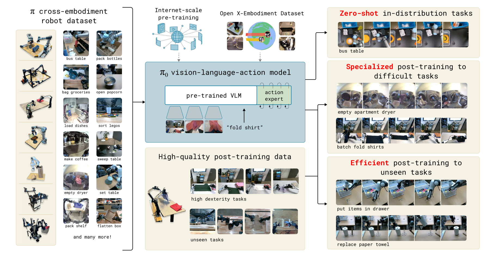

# 双专家共享注意力

**代表工作**：π0

**核心思想**：同一套 Transformer 权重里并行跑两个专家——expert 0（PaliGemma）处理「图像 + 语言」前缀，expert 1（Action Expert）处理「状态 + 加噪动作」后缀；两者各自投影 q/k/v 后**沿 head 维拼接**做一次共享注意力，从而在同一注意力空间里对齐视觉-语言表示与动作表示。

## 论文主图

<figure markdown>
  { width="100%" }
  <figcaption>
    π0 论文 Figure 1（Physical Intelligence，<i>π0: A Vision-Language-Action Flow Model for General Robot Control</i>，arXiv:2410.24164）。
    中间蓝框即双专家结构：<code>pre-trained VLM</code> 与 <code>action expert</code> 并排、共享注意力；
    左侧是跨本体预训练数据，下方是高质量后训练数据，右侧是「零样本 / 专精 / 高效」三类下游任务。
  </figcaption>
</figure>

**要点**

- expert 0 权重名不带后缀，可直接加载官方 PaliGemma 权重；expert 1 带 `_1` 后缀，从零初始化
- 前缀看不到后缀（`ar_mask` 阻断），后缀内部动作 token 之间双向可见
- 共享注意力的前提：各专家 `head_dim` / `num_heads` / `num_kv_heads` 必须一致

**论文源文件**：[π0 模型梳理](../papers/pi0_model_architecture.md)

## 笔记

（待补充）
