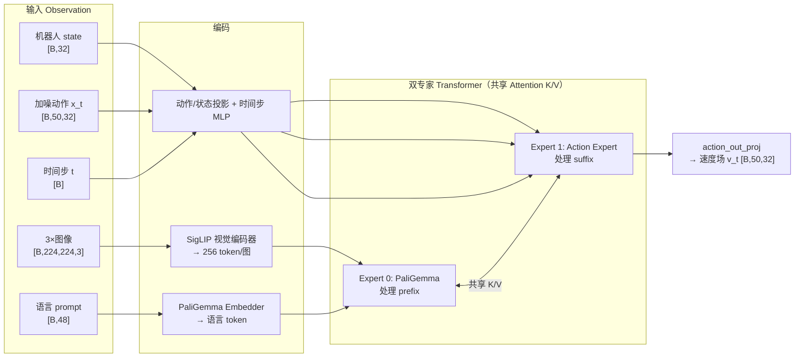

# π0 模型梳理

> 本文档仅梳理 **π0**（flow matching 版，非 π0.5 / π0-FAST）。
> 路径相对于仓库根目录 `openpi/`，行号基于当前 `main` 分支。

---

## 1. 概述

### 1.1 模型整体架构

π0 是一个 **3.3B 参数的 Vision-Language-Action（VLA）模型**：以预训练 VLM 理解图像与语言，再通过一个 flow matching 动作专家生成连续动作 chunk。

**参数构成**：

| 组件 | 参数量 | 说明 |
|---|---|---|
| PaliGemma 骨干（expert 0） | ~3B | SigLIP-So400m 视觉编码器 + Gemma-2B 语言模型 |
| Action Expert（expert 1） | ~300M | 从零初始化，Gemma 同构但更窄 |
| **合计** | **~3.3B** | `src/openpi/models/pi0.py` |

**架构总览**：

**模块清单**（对应后续章节）：

| 章节 | 模块 | 源码 |
|---|---|---|
| 2 | 视觉编码模块（SigLIP） | `models/siglip.py` |
| 3 | 语言 Tokenizer 模块 | `models/tokenizer.py` |
| 4 | 双专家 Transformer 骨干（Gemma） | `models/gemma.py` |
| 5 | 前缀编码模块（embed_prefix） | `models/pi0.py` |
| 6 | 后缀编码与动作投影模块（embed_suffix） | `models/pi0.py` |
| 7 | 注意力掩码与位置编码机制 | `models/pi0.py` / `models/gemma.py` |
| 8 | Flow Matching 动作头模块 | `models/pi0.py` |
| 9 | LoRA 低秩适配模块（可选） | `models/lora.py` |

**关键配置**（`models/gemma.py:58` `get_config`）：

| 配置 | width | depth | mlp_dim | num_heads | num_kv_heads | head_dim |
|---|---|---|---|---|---|---|
| `gemma_2b`（expert 0） | 2048 | 18 | 16384 | 8 | 1 | 256 |
| `gemma_300m`（expert 1） | 1024 | 18 | 4096 | 8 | 1 | 256 |

---

### 1.2 训练 Stage 与参数训练策略

π0 借鉴 LLM 的「预训练 + 后训练」范式，采用多阶段训练。**从代码视角看**，一个模型实例的训练策略由 `TrainConfig.freeze_filter`（`training/config.py:493`）与 `weight_loader` 共同决定。

#### Stage 0：权重初始化（训练前）

| 组件 | 初始化来源 | 代码 |
|---|---|---|
| PaliGemma 骨干 | 官方 PaliGemma 权重，或 `pi0_base` 检查点 | `weight_loaders.PaliGemmaWeightLoader` / `CheckpointWeightLoader` |
| Action Expert | **随机初始化（从零）** | `pi0.py:92-100` 的投影层与 `gemma.py` expert 1 权重 |

> `gemma.py:443` 的 `_name()` 让 expert 0 的权重名无后缀（如 `attn`），从而能**无缝加载官方 PaliGemma 权重**；expert 1 加后缀 `_1`（如 `attn_1`），从零训练。

#### Stage 1：预训练（Pre-training）

| 项目 | 内容 |
|---|---|
| 目标 | 获得广泛通用的物理能力与泛化性 |
| 数据 | 自采灵巧操作数据（~10000 小时、7 种机器人构型、68 个任务）+ OXE 数据集（22 个机器人）+ 多样语言标签（任务名 + 段标注） |
| **训练的参数** | **全部参数**（PaliGemma 骨干 + action expert，联合训练） |
| 损失 | 文本 token 交叉熵 + 动作 flow matching MSE（同一前向、联合优化） |
| 代码对应 | `freeze_filter = nnx.Nothing`（默认，`config.py:493`），`weight_loader` 指向 `pi0_base` |

#### Stage 2：后训练 / 微调（Post-training）

| 项目 | 内容 |
|---|---|
| 目标 | 在目标任务上熟练、流畅执行 |
| 数据 | 目标任务的高质量遥操作演示（论文经验：**每任务约 50 条**即可） |
| **训练的参数** | **全部参数**（full fine-tuning，与预训练同为全量更新） |
| 损失 | 同 Stage 1（文本 CE + flow matching MSE） |
| 代码对应 | 如 `pi0_libero`（`config.py:653`），`weight_loader` 指向 `pi0_base`，`num_train_steps=30000` |

#### 可选 Stage 2'：LoRA 低秩微调

| 项目 | 内容 |
|---|---|
| 目标 | 低显存微调（单卡 4090 可跑） |
| **训练的参数** | **仅 LoRA 权重 + action expert**；PaliGemma 骨干主干冻结 |
| 代码对应 | `pi0_libero_low_mem_finetune`（`config.py:679`）：`paligemma_variant="gemma_2b_lora"`、`action_expert_variant="gemma_300m_lora"`、`freeze_filter=...get_freeze_filter()`、`ema_decay=None` |

#### 冻结策略的代码实现

- 每个模型配置提供 `get_freeze_filter()`（`pi0_config.py:88` / `pi0_fast.py:127`）返回默认冻结过滤器；
- LoRA 场景：`nnx.All(PathRegex(".*llm.*"), nnx.Not(PathRegex(".*lora.*")))` —— 冻结骨干中所有**非 LoRA** 参数；
- 实际可训练参数 = `TrainConfig.trainable_filter`（`config.py:550`）= `nnx.All(nnx.Param, nnx.Not(freeze_filter))`；
- 冻结参数在初始化时被转成 bfloat16（`train.py:104`）以省显存。

**三阶段参数训练策略汇总**：

| Stage | 数据规模 | PaliGemma 骨干 | Action Expert | 损失 |
|---|---|---|---|---|
| 0 初始化 | — | 加载官方/PG 权重 | 随机 | — |
| 1 预训练 | ~1 万小时 + OXE | ✅ 全量训练 | ✅ 全量训练 | 文本 CE + FM MSE |
| 2 后训练 | ~50 条/任务 | ✅ 全量微调 | ✅ 全量微调 | 文本 CE + FM MSE |
| 2' LoRA | 少量 | 🔒 冻结（仅 LoRA 可训） | ✅ 训练 | 文本 CE + FM MSE |

---

## 2. 视觉编码模块（SigLIP）

**源码**：`src/openpi/models/siglip.py`，实例化于 `pi0.py:81-91`。

**功能**：把 3 路 RGB 图像分别编码为 patch token 序列，作为 Transformer 前缀的视觉部分。

**输入**：

| 变量名 | 含义 | shape |
|---|---|---|
| `image` | 单路 RGB 图像，float32 ∈ [-1,1] | `[B, 224, 224, 3]` |

**输出**：

| 变量名 | 含义 | shape |
|---|---|---|
| `x` | 图像 token 嵌入（经 head 投影到 PaliGemma 宽度） | `[B, 256, 2048]` |
| `out` | 中间激活字典（调试用） | dict |

**内部结构**（variant `So400m/14`）：width=1152、depth=27、mlp_dim=4304、num_heads=16、patch_size=(14,14)、`pool_type="none"`、`scan=True`、`num_classes=2048`。

**处理流程**（`siglip.py:208`）：
1. 输入转 float32。
2. **Patch 提取**：`nn.Conv(width=1152, kernel=(14,14), stride=(14,14), padding="VALID")` → `[B,16,16,1152]` → reshape `[B,256,1152]`（224/14=16，共 256 个 patch）。
3. **位置编码**：`posemb="learn"`（可学习）加到 patch token 上（`siglip.py:229`）。
4. 转回 `dtype_mm`（bfloat16）。
5. **Encoder**：27 层 `Encoder1DBlock`（LayerNorm → MHSA → 残差 → LayerNorm → MLP → 残差），用 `nn.scan` + remat 省显存。
6. 输出 LayerNorm。
7. `pool_type="none"` → 不做池化，返回全部 256 个 token。
8. 经 `num_classes` head（`nn.Dense(2048)`）投影到 PaliGemma 宽度 → `[B,256,2048]`。

> 3 路图像共用同一个 SigLIP（权重共享），各自得到 256 token，合计 768 个图像 token。

---

## 3. 语言 Tokenizer 模块

**源码**：`src/openpi/models/tokenizer.py`，`PaligemmaTokenizer`（`tokenizer.py:14`）。

**功能**：把自然语言指令转成 PaliGemma 词表的 token id 序列 + mask。

**输入**：

| 变量名 | 含义 | 类型 |
|---|---|---|
| `prompt` | 语言指令，如 "pick up the fork" | str |
| `state` | 机器人状态（**π0 传 None**，π0.5 才用） | `np.ndarray \| None` |

**输出**：

| 变量名 | 含义 | shape |
|---|---|---|
| `tokens` | token id（含 BOS 与结尾换行） | `[48]` int32 |
| `mask` | 有效性掩码（padding 为 False） | `[48]` bool |

**内部结构**：`max_len=48`；底层是 SentencePiece 模型（`gs://big_vision/paligemma_tokenizer.model`）；词表大小 `PALIGEMMA_VOCAB_SIZE=257152`。

**处理流程**（`tokenizer.py:22`）：
1. 清洗文本：`strip()`、下划线换空格、换行换空格。
2. **π0 格式**（`state is None`）：`encode(text, add_bos=True) + encode("\n")`（`\n` 作为「答案开始」标记）；**状态不进语言 token**，而是作为连续输入给 action expert（见第 6 章）。
3. 长度不足 `max_len` → 右侧 padding（token 补 0、mask 补 False）；超长则截断并告警。
4. 返回 `(tokens, mask)`，最终由 `TokenizePrompt` 变换（`transforms.py:248`）写入 `Observation`。

---

## 4. 双专家 Transformer 骨干（Gemma）

**源码**：`src/openpi/models/gemma.py`，核心类 `Module`（`gemma.py:340`）。这是 π0 的「网络主体」，也是最关键的设计。

**功能**：一套 Transformer 权重里并行跑**两个专家**——expert 0（PaliGemma，处理图像+语言前缀）与 expert 1（Action Expert，处理状态+动作后缀），两者**共享 Attention 的 K/V**，从而在同一个注意力空间里对齐视觉-语言表示与动作表示。

**输入**：

| 变量名 | 含义 | shape |
|---|---|---|
| `embedded` | 各专家的 token 嵌入列表 `[prefix, suffix]` | `[B,768+L,2048]`、`[B,51,1024]` |
| `positions` | 各 token 位置索引 | `[B, S]` int32 |
| `mask` | 注意力掩码 | `[B,1,S,S]` bool |
| `adarms_cond` | adaRMS 条件（π0 为 None） | `[None, None]` |
| `kv_cache` | KV 缓存（推理时用） | tuple \| None |

**输出**：

| 变量名 | 含义 | shape |
|---|---|---|
| `embedded` | 各专家输出隐状态 | `[B,768+L,2048]`、`[B,51,1024]` |
| `kv_cache` | 更新后的 KV 缓存 | tuple |

**内部结构**：
- `Embedder`（`gemma.py:135`）：词表 257152，embed_dim = expert 0 宽度 2048；
- `layers`：`nn.scan` 的 18 层 `Block`；
- `Block`（`gemma.py:284`）：`RMSNorm → Attention → gated residual → RMSNorm → FeedForward → gated residual`；
- `Attention`（`gemma.py:158`）：**每个专家有独立的 q/k/v einsum**（命名 `attn` / `attn_1`），把两个专家的 q/k/v **沿 head 维拼接**后做一次共享注意力，再按专家切分输出；
- `final_norms`：每个专家各自的最终 RMSNorm。

**处理流程**（`gemma.py:389`）：
1. 各专家嵌入转 `embed_dtype`。
2. 进入 `layers`（18 层 `Block`）：
   - 每个专家的输入过 `pre_attention_norm`（RMSNorm）；
   - `Attention` 用各专家的 q/k/v 权重投影，**拼接所有专家的 q/k/v**（要求 head_dim/num_heads/num_kv_heads 一致）；
   - 加 **RoPE** 位置编码（`_apply_rope`，`gemma.py:424`）；
   - 做一次多头注意力（可带 KV cache）；
   - 按专家边界切回各自输出，各专家独立 `attn_vec_einsum` 输出投影；
   - gated residual 相加；FFN 同理。
3. `final_norms` 逐专家归一化后返回。

**关键点**：`_name(name, i)`（`gemma.py:443`）——expert 0 权重名不带后缀，可加载官方 PaliGemma；expert i>0 带 `_i` 后缀，从零初始化。

---

## 5. 前缀编码模块（embed_prefix）

**源码**：`src/openpi/models/pi0.py:106`。

**功能**：把图像 token 与语言 token 拼成 Transformer 的前缀（prefix）。

**输入**：

| 变量名 | 含义 | shape |
|---|---|---|
| `obs.images[name]` | 3 路图像 | `[B,224,224,3]` |
| `obs.image_masks[name]` | 图像掩码 | `[B]` bool |
| `obs.tokenized_prompt` | 语言 token | `[B,48]` int32 |
| `obs.tokenized_prompt_mask` | prompt 掩码 | `[B,48]` bool |

**输出**：

| 变量名 | 含义 | shape |
|---|---|---|
| `tokens` | 前缀嵌入 | `[B, 768+L, 2048]` |
| `input_mask` | 有效性掩码 | `[B, 768+L]` bool |
| `ar_mask` | 注意力结构掩码（全 False → 双向） | `[768+L]` bool |

**处理流程**（`pi0.py:106`）：
1. 遍历 3 路图像，各自过 `PaliGemma.img(...)` 得 256 个 token；`input_mask` 按 `image_masks` 扩展；`ar_mask` 追加 256 个 `False`（图像 token 互相全可见）。
2. 语言 token 过 `PaliGemma.llm(tokenized_prompt, method="embed")` 得嵌入；`ar_mask` 追加 L 个 `False`（与图像全双向注意力）。
3. 沿序列维拼接 `tokens` / `input_mask` / `ar_mask` 并返回。

---

## 6. 后缀编码与动作投影模块（embed_suffix）

**源码**：`src/openpi/models/pi0.py:140`。

**功能**：把机器人状态、加噪动作、flow matching 时间步编码成 Transformer 的后缀（suffix），并给出 adaRMS 条件。

**输入**：

| 变量名 | 含义 | shape |
|---|---|---|
| `obs.state` | 机器人状态 | `[B,32]` |
| `noisy_actions` (`x_t`) | 加噪动作 | `[B,50,32]` |
| `timestep` | flow matching 时间步 | `[B]` |

**输出**：

| 变量名 | 含义 | shape |
|---|---|---|
| `tokens` | 后缀嵌入 | `[B,51,1024]` |
| `input_mask` | 有效性掩码 | `[B,51]` bool |
| `ar_mask` | 结构掩码（首 token True + 49 个 False） | `[51]` bool |
| `adarms_cond` | adaRMS 条件（π0 为 None） | `None` |

**涉及的可学习投影层**（`pi0.py:92-100`）：

| 层 | 作用 | 维度 |
|---|---|---|
| `action_in_proj` | 加噪动作 → 动作专家宽度 | 32 → 1024 |
| `state_proj` | 状态 → 1 个 token | 32 → 1024 |
| `action_time_mlp_in` | 融合 动作token‖时间嵌入 | 2048 → 1024 |
| `action_time_mlp_out` | 融合后投影 | 1024 → 1024 |
| `action_out_proj` | 隐状态 → 速度场 | 1024 → 32 |

**处理流程**（π0，非 π0.5，`pi0.py:151-186`）：
1. **状态 token**：`state_proj(state)` → `[B,1,1024]`；`ar_mask` 追加 `True`（前缀看不到状态 token）。
2. **动作 token**：`action_in_proj(x_t)` → `[B,50,1024]`。
3. **时间步编码**：`posemb_sincos(timestep, 1024, min_period=4e-3, max_period=4.0)` → `[B,1024]`。
4. **时间融合**（π0 用 MLP，非 adaRMS）：把时间嵌入复制到 50 步 → 与动作 token 拼接 → `action_time_mlp_in → swish → action_time_mlp_out → swish`。
5. `ar_mask` 追加 `True + [False]*49`（动作 token 互相双向可见）。
6. 拼接状态 token + 动作 token，返回 `tokens/mask/ar_mask`（π0 的 `adarms_cond=None`）。

> π0.5 的差异：不做状态 token（状态进入语言 token），改用 `time_mlp_in/out` 生成 `adarms_cond` 经 adaRMS 注入时间步（`pi0.py:162-169`、`gemma.py:127`）。

---

## 7. 注意力掩码与位置编码机制

**源码**：`pi0.py:19`（`make_attn_mask`）、`pi0.py:48`（`posemb_sincos`）、`gemma.py:424`（`_apply_rope`）。

**功能**：控制 token 之间「谁能看见谁」，以及为 token 提供位置信息。

**`make_attn_mask(input_mask, mask_ar)`**：

| 输入 | 含义 | shape |
|---|---|---|
| `input_mask` | 有效性 | `[B, N]` bool |
| `mask_ar` | 因果结构（True=与前一个 token 分块） | `[B, N]` bool |

| 输出 | 含义 | shape |
|---|---|---|
| `attn_mask` | 注意力可见性 | `[B, N, N]` bool |

原理：对 `mask_ar` 做 cumsum，token 只能看见 cumsum 不大于自身的 token。例：全 0 → 双向；`[0,0,0,1,1,1]` → 前 3 个双向、后 3 个因果。

**π0 的注意力结构**（拼接 prefix + suffix 后）：
- **prefix 内部**（图像 ↔ 语言）：全双向（`ar_mask` 全 False）；
- **suffix 内部**：状态 token 与动作 token 分块，动作 token 之间双向；
- **prefix 看不到 suffix**：状态与动作 token 的 `ar_mask=True` 阻断前缀对它们的依赖。

**位置编码**：
- **序列位置**：`positions = cumsum(input_mask) - 1`，供 Transformer 使用；
- **RoPE**（`gemma.py:424`）：在 Attention 中对 q/k 施加旋转位置编码，`max_wavelength=10000`；
- **时间步编码**（`posemb_sincos`，`pi0.py:48`）：对 flow matching 时间步做 sin-cos 编码，`min_period=4e-3`、`max_period=4.0`。

---

## 8. Flow Matching 动作头模块

**源码**：`pi0.py:189`（`compute_loss`）、`pi0.py:217`（`sample_actions`）。

**功能**：训练时学习「加噪动作 → 去噪速度场」的回归；推理时从纯噪声迭代去噪生成动作 chunk。这是 π0 输出连续动作的核心。

### 8.1 训练：`compute_loss`

**输入**：

| 变量名 | 含义 | shape |
|---|---|---|
| `rng` | 随机种子 | `jax.Array` |
| `observation` | 观测 | `Observation` |
| `actions` | 真实动作 chunk | `[B,50,32]` |
| `train` | 训练态标志（控制图像增强） | bool |

**中间量**：

| 变量名 | 含义 | shape |
|---|---|---|
| `noise` | 高斯噪声 | `[B,50,32]` |
| `time` | 采样时间步 ~ Beta(1.5,1)·0.999+0.001 | `[B]` |
| `x_t` | 加噪动作 `t·noise+(1-t)·actions` | `[B,50,32]` |
| `u_t` | 目标速度场 `noise-actions` | `[B,50,32]` |
| `v_t` | 网络预测速度场 | `[B,50,32]` |

**输出**：

| 变量名 | 含义 | shape |
|---|---|---|
| `chunked_loss` | 每步动作的 MSE | `[B,50]` |

**处理流程**（`pi0.py:192-214`）：
1. `preprocess_observation`（`model.py:144`）：训练态做图像增强（RandomCrop 0.95 / Resize / Rotate ±5° / ColorJitter），补齐 `image_mask`。
2. 采样 `noise` 与 `time`（Beta 分布偏向更噪时间步）。
3. 构造 `x_t`、`u_t`。
4. `embed_prefix` + `embed_suffix`（第 5、6 章）→ 拼接 → `make_attn_mask` → 一次前向 `PaliGemma.llm([prefix, suffix], ...)`。
5. `v_t = action_out_proj(suffix_out[:, -50:])`。
6. 返回 `mean(square(v_t - u_t), axis=-1)`。

### 8.2 推理：`sample_actions`

**输入**：`rng`、`observation`、`num_steps=10`（去噪步数）、`noise=None`。

**输出**：`x_0` —— 生成的动作 chunk，`[B,50,32]`。

**处理流程**（`pi0.py:217-279`）：
1. 约定 `t=1` 为噪声、`t=0` 为目标分布；`dt = -1/num_steps`。
2. 从纯高斯噪声出发。
3. 先对 prefix 前向一次，填充 **KV cache**。
4. `jax.lax.while_loop` 迭代 `num_steps` 次：
   - `embed_suffix` 编码当前 `x_t` 与时间步；
   - 用 KV cache 前向 suffix，得 `v_t`；
   - Euler 更新 `x_t = x_t + dt·v_t`，`time += dt`。
5. 返回去噪后的 `x_0`。

---

## 9. LoRA 低秩适配模块（可选）

**源码**：`src/openpi/models/lora.py`。

**功能**：为 Gemma 的 `Einsum` 与 `FeedForward` 注入低秩旁路，实现低显存微调。

**输入/输出**：与原模块完全一致（drop-in 替换），仅在权重上追加 LoRA 参数。

**核心结构**：

| 组件 | 位置 | 说明 |
|---|---|---|
| `LoRAConfig` | `lora.py:11` | `rank`、`alpha`、`scaling_value = alpha/rank`（或 rsLoRA 用 `alpha/√rank`） |
| `Einsum` | `lora.py:33` | 基础权重 `w` + 旁路 `lora_a`/`lora_b` |
| `FeedForward` | `lora.py:88` | gating / linear 两条线性层各加 LoRA |

**处理流程**：
1. `Einsum.setup`（`lora.py:43`）：若 `lora_config` 非空，额外建 `w_a`、`w_b` 参数。
2. `__call__`（`lora.py:54`）：`result = einsum(x, w) + einsum(einsum(x, w_a), w_b) * scaling_value`。
3. `_make_lora_eqns`（`lora.py:67`）：自动在 einsum 方程里插入低秩维 `L`，生成两步 einsum。
4. 启用方式：模型配置 `paligemma_variant="gemma_2b_lora"`（rank=16）、`action_expert_variant="gemma_300m_lora"`（rank=32）；配合 `get_freeze_filter()` 冻结骨干非 LoRA 参数。

---

## 附：模块与配置对照速查

| 模块 | 关键配置项 | 默认值 |
|---|---|---|
| 动作维度 | `Pi0Config.action_dim` | 32 |
| 动作 chunk 长度 | `Pi0Config.action_horizon` | 50 |
| prompt 最大长度 | `Pi0Config.max_token_len` | 48 |
| 骨干精度 | `Pi0Config.dtype` | bfloat16 |
| 视觉编码器 | `variant` | So400m/14（256 token/图） |
| 骨干专家 | `paligemma_variant` / `action_expert_variant` | gemma_2b / gemma_300m |
| 去噪步数 | `sample_actions(num_steps=)` | 10 |
| LoRA 秩 | `gemma_2b_lora` / `gemma_300m_lora` | 16 / 32 |
